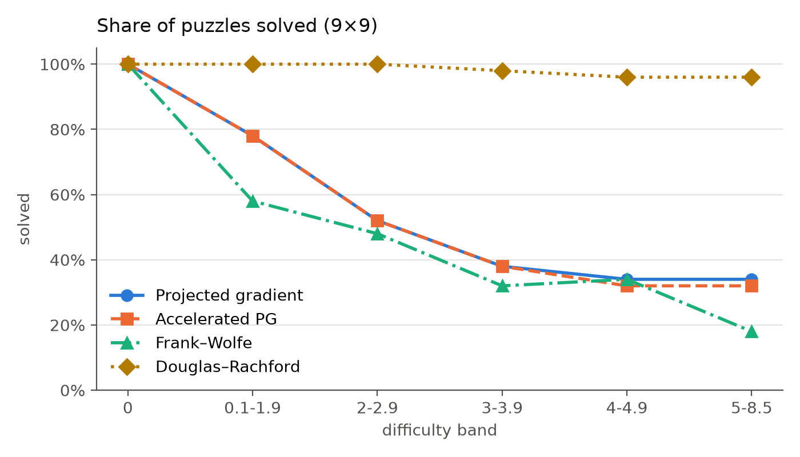

# Solving Sudoku with Continuous Optimization

Course project for ISE/CSCI 633 (Large Scale Optimization for Machine Learning), USC, Fall 2026.

We solve Sudoku with constrained first-order methods instead of combinatorial search. Each cell gets nine weights, one per digit, that lie on a probability simplex. The objective penalizes rows, columns and boxes that do not contain each digit exactly once, plus a term that pushes weights toward 0 or 1. We compare how often each method solves a puzzle and how this depends on puzzle difficulty.

**Main question:** how well can the course's constrained first-order methods solve Sudoku through a continuous relaxation, and how does their success depend on how hard the puzzle is for combinatorial search?

## Methods

| Method | Idea | Status |
| --- | --- | --- |
| Projected gradient | gradient step, then project each cell onto the simplex (Armijo step) | done |
| Accelerated projected gradient | Nesterov extrapolation before the projected step, with restart | done |
| Frank–Wolfe | move toward the best digit per cell under the gradient (Armijo or 2/(t+2) step) | done |
| Douglas–Rachford | projections onto the exact 0/1 rules with reflections (outside the course, for comparison; follows Aragón Artacho, Borwein & Tam 2014) | done |

## Data

Kaggle dataset **"3 million Sudoku puzzles with ratings"** (CC0). Each row has a puzzle, its solution, the number of clues and a difficulty rating from 0 to 8.5.

The full file is not in this repository. Download it from Kaggle into `data/`, then make a small stratified sample:

```bash
python scripts/make_sample.py --data data/<dataset file>.csv --per-band 50 --out data/dev_sample.csv
```

This branch covers 9×9 puzzles only (no N×N generalization). Committed sample: `data/dev_sample.csv` (300 puzzles, 50 per difficulty band).

## Setup

```bash
python -m venv .venv && source .venv/bin/activate
pip install -r requirements.txt
python -m pytest -q          # all tests should pass
python experiments/run_benchmark.py --sample data/dev_sample.csv --out results/dev_run.csv
python experiments/plots.py --results "results/*.csv"     # figures in results/figures/
```

## Layout

```
src/sudoku.py        loading, parsing, solution checks, sampling (9x9 only)
src/objective.py     relaxation: simplex projection, objective and gradient, helpers
src/methods.py       the four methods, shared Result type
experiments/         benchmark runs, final experiments (run_final.sh), shared figures (plots.py)
scripts/             data preparation (Kaggle sample)
references/papers/   papers we build on
tests/               unit tests
notebooks/           exploration and figures
results/             tables and figures for the report
```

## Results

Full tables: [`results/final/README.md`](results/final/README.md). Reproduce with `bash experiments/run_final.sh`.

9×9 Kaggle sample (300 puzzles), one start, at most 3000 iterations per method:

| | Projected gradient | Accelerated PG | Frank–Wolfe | Douglas–Rachford |
| --- | --- | --- | --- | --- |
| Solved | 168/300 | 166/300 | 145/300 | 295/300 |

The course methods solve every easy puzzle but fall to about a third on the hardest bands; Douglas–Rachford is almost unaffected by difficulty.



## References

- F. J. Aragón Artacho, J. M. Borwein, M. K. Tam. Recent Results on Douglas–Rachford Methods for Combinatorial Optimization Problems. *Journal of Optimization Theory and Applications*, 2014. [arXiv:1305.2657](https://arxiv.org/abs/1305.2657)

## Team

- Raushan Kossayeva
- Gracy Patel
