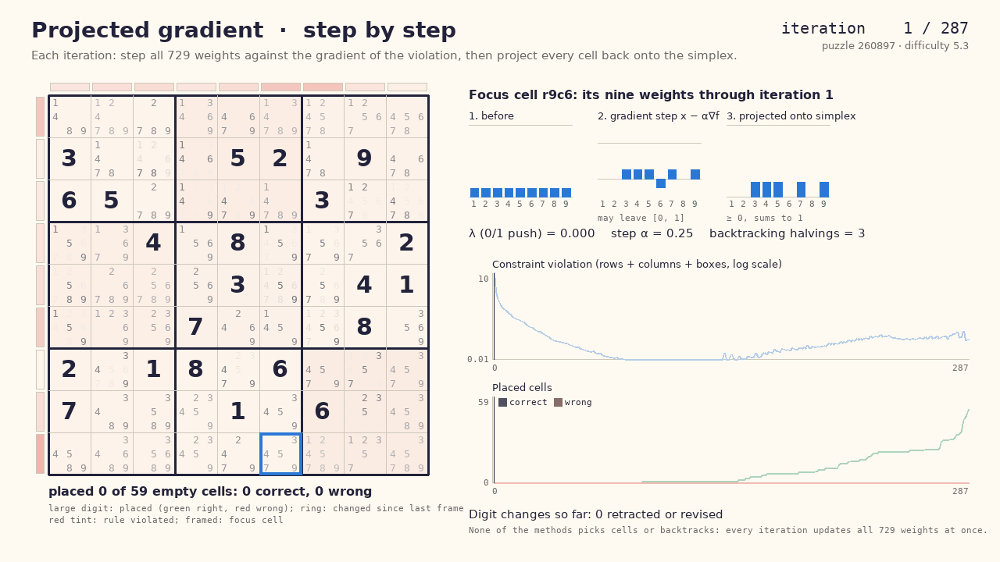
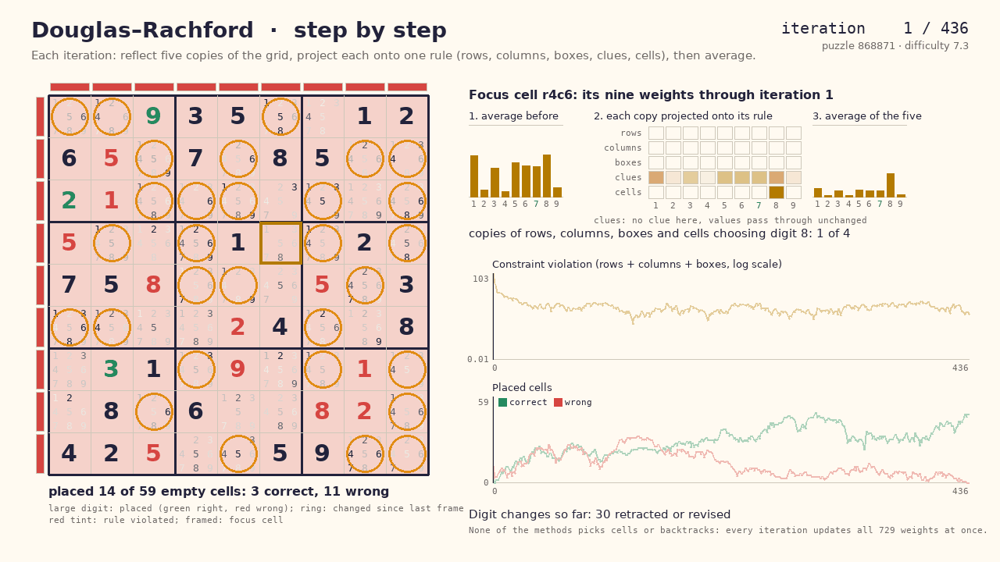
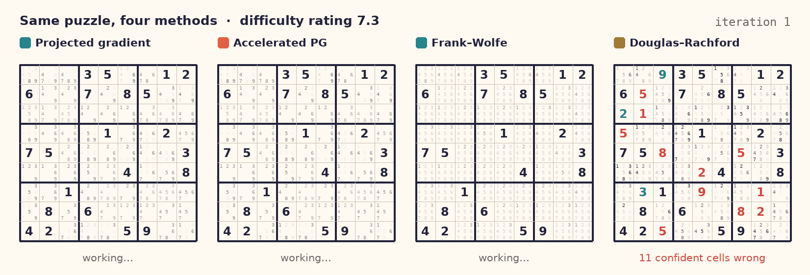

# How the four methods solve a Sudoku, step by step

This folder holds iteration-by-iteration data for all four methods on two test puzzles, recorded from the real runs. The animations in `results/figures/animation/` are drawn from it.

**What these methods do not do:** projected gradient (PG), accelerated projected gradient (APG), Frank–Wolfe (FW) and Douglas–Rachford (DR) never select a cell, place one digit at a time, or backtrack through a search tree. Every iteration updates all 729 weights at once (81 cells × 9 digits). What *can* be shown faithfully is:

| What you see | What it really is |
| --- | --- |
| Constraint checking | The violation of every row, column and box: the quantity PG, APG and FW minimise, and the rules DR projects onto |
| Candidate selection | FW's target digit in every cell; DR's copies for rows, columns, boxes and cells, each snapping to the strongest digit for its rule (the fifth, clue copy only fixes the clues); for PG and APG, the leading digit of each cell |
| Placement | A cell counts as placed when one digit holds more than 85 % of its weight (for DR: of the average of its five copies) |
| Retraction / revision | A placed digit that drops back below 85 % (retraction) or is replaced by another digit (revision). The closest these methods come to backtracking |

## The two test cases

| Puzzle | Difficulty | Empty cells | Why it was chosen |
| --- | --- | --- | --- |
| [260897](260897/summary.json) | 5.3 | 59 | Hardest puzzle in the 300-puzzle sample that all four methods solve from one start |
| [868871](868871/summary.json) | 7.3 | 59 | Hardest puzzle in the sample; only DR solves it |

Every run is exactly the one in experiment E1 (seed 0, at most 3000 iterations), recorded without changing it.

## Projected gradient on puzzle 260897



How to read it:
- **Left:** the whole grid. Small digits are each cell's weights (darker = larger). A large digit is a placed cell: green if it matches the solution, red if not. A ring marks a cell whose digit changed since the previous frame. Red tint on the strips beside the grid and on the boxes means that rule is currently violated. The framed cell is the focus cell.
- **Top right:** the focus cell r9c6 (solution digit 9) through one iteration: its nine weights before, after the gradient step (where they can leave [0, 1]), and after projection back onto the simplex (non-negative, summing to 1). Below that: λ (how hard the 0/1 term pushes), the step size α and the number of backtracking halvings in the line search.
- **Bottom right:** constraint violation over the run (log scale) and the number of placed cells, correct and wrong.

The run ends at iteration 287 because the leading digits already form a valid grid; 50 of the 59 empty cells are placed by then. The focus cell is still split between 3 and 9 at that point, but 9 leads.

## Douglas–Rachford on puzzle 868871



Same layout as above. The top right shows the focus cell r4c6 (solution digit 7) through one iteration: the average before, then what each of the five copies becomes after it is projected onto its own rule, then the new average. The rows, columns, boxes and cells copies always pick exactly one digit (a filled square). The clue copy only sets the clue digits to 1 and passes every other value through unchanged, so for a non-clue cell its row shows real values (shade = value) rather than a choice. Placed digits keep appearing and disappearing in the grid: DR does not settle cell by cell, but jumps between candidate grids until one satisfies every rule, here at iteration 436.

## All four methods on puzzle 868871



Each panel shows a method's weights on the same puzzle, on a shared, roughly logarithmic time line up to iteration 3000. A large digit means one digit holds more than 85 % of the cell: green if correct, red if not. The three gradient methods fill the grid smoothly and lock into wrong digits (PG and APG end on exactly the same wrong grid), then stop at the 3000-iteration cap. DR's grid is noisy throughout and solves the puzzle at iteration 436.

## Results

### Puzzle 260897: all four methods solve it

| | PG | APG | FW | DR |
| --- | --- | --- | --- | --- |
| Solved at iteration | 287 | 261 | 406 | 411 |
| Cells placed when solved (of 59) | 50 | 52 | 52 | 42 |
| Placements during the run | 50 | 52 | 60 | 1,332 |
| Wrong placements | 0 | 0 | 5 | 732 |
| Retractions | 0 | 0 | 8 | 1,340 |
| Revisions | 0 | 0 | 0 | 10 |

### Puzzle 868871: only DR solves it

| | PG | APG | FW | DR |
| --- | --- | --- | --- | --- |
| Result | stuck at the 3000 cap | stuck at the 3000 cap | stuck at the 3000 cap | solved at iteration 436 |
| Cells placed at the end (of 59) | 58 | 58 | 57 | 47 |
| … of which wrong | 15 | 15 | 7 | 0 |
| Cells whose leading digit is wrong at the end | 16 | 16 | 9 | 0 |
| Wrong placements during the run | 22 | 20 | 8 | 511 |
| Retractions | 12 | 9 | 15 | 1,236 |
| Revisions | 0 | 0 | 0 | 16 |
| Lowest constraint violation reached | 0.01 | 0.01 | below 0.001 | — |
| Constraint violation at the end | 1.77 | 1.77 | 1.00 | — |

DR's violation is measured on the average of its five copies, so it is not comparable with the other three and is left out of the last two rows.

## What the data shows

1. **The gradient methods never change their mind directly.** Across both puzzles, PG, APG and FW make zero revisions. A wrong digit can only be retracted (its weight falls below 85 %), and on 260897 PG and APG never place a wrong digit at all.
2. **APG's momentum is almost always switched off.** On 260897 its momentum was reset in 194 of 261 iterations, and on 868871 in 1,805 of 3000. The restart rule fires whenever the objective goes up, and the objective keeps rising because λ grows every iteration. So APG behaves much like PG, which explains why their results are nearly identical in every experiment.
3. **FW commits early and corrects itself.** Each iteration moves only a small part of the way toward its target (on average γ ≈ 0.025 on 260897), yet it places 5 wrong digits on 260897 before retracting them.
4. **DR explores instead of settling.** Its average keeps placing and dropping digits: on 260897 it makes 1,332 placements and 1,340 retractions, more than 20 times as many digit changes as the other methods, and still solves at iteration 411. This churn is how DR moves between candidate grids instead of locking into one.
5. **On the hard puzzle, the gradient methods find a "solution" that isn't one.** On 868871, FW drives the constraint violation below 0.001: the rows, columns and boxes all sum correctly, but with fractional weights. As λ pushes the weights to 0 or 1, the methods lock into wrong digits (PG and APG end with 15 wrong placements, FW with 7) and the violation climbs back to 1–1.8. DR never settles, so it doesn't get trapped, and it solves the puzzle at iteration 436.
6. **"Solved" doesn't mean every cell is placed.** Every method stops as soon as the leading digit of each cell forms a valid grid. At that moment 42–52 of the 59 empty cells are placed; the rest still lean the right way without passing 85 %.

## What is in each folder

| File | Contents |
| --- | --- |
| `summary.json` | Puzzle, solution, focus cell and per-method totals |
| `events.json` | For each method, every placement, retraction and revision: iteration, row, column, old and new digit, and whether the new digit is correct |
| `pg.npz`, `apg.npz`, `fw.npz`, `dr.npz` | Per-iteration arrays (index 0 is the start) |

Arrays in the `.npz` files:

| Array | Methods | Contents |
| --- | --- | --- |
| `x` | all | Weights after each iteration, shape (T+1, 9, 9, 9), float16. For DR: the average of the five copies |
| `row_v`, `col_v`, `box_v` | all | Violation of each of the 9 rows / columns / boxes: ½ Σ over digits of (group sum − 1)² |
| `lam` | PG, APG, FW | Weight λ of the 0/1 term |
| `step`, `halvings` | PG, APG | Accepted step size and line-search halvings |
| `beta`, `used_momentum`, `restart` | APG | Momentum coefficient, whether the momentum point was used, whether momentum was reset |
| `gamma`, `halvings` | FW | Share of the way moved toward the target, and line-search halvings |
| `target` | FW | Target digit chosen in every cell, (T, 9, 9) |
| `projections`, `sets` | DR | The four 0/1 copies after projection (rows, columns, boxes, cells), bit-packed: `np.unpackbits(projections, axis=-1, count=9)` |
| `clue_copy` | DR | The clue copy after projection, float16: clue digits set to 1, every other value passed through (can be below 0 or above 1) |
| `focus_*` | all | The focus cell's nine weights at each stage of the iteration (before, gradient step, momentum point, target, or for DR the average before and all five projected copies) |
| `solved`, `iterations` | all | Outcome of the run |

The focus cell is the empty cell whose digit changed most often across the four methods (r9c6 for 260897, r4c6 for 868871).

## Reproduce

```bash
python experiments/record_steps.py --id 260897
python experiments/record_steps.py --id 868871
python experiments/animate_steps.py --id 260897 --method pg    # --method pg | apg | fw | dr
python experiments/animate_steps.py --id 868871 --method dr
python experiments/animate.py --id 868871 --out results/figures/animation/race_868871.gif
```

The data is recorded through the `trace` and `callback` hooks in `src/methods.py`; a unit test checks that recording never changes a run. Rendered so far: PG step by step on 260897, DR step by step on 868871, and the four-method comparison on 868871. The other step-by-step animations come from the same command with a different `--id` or `--method`.
